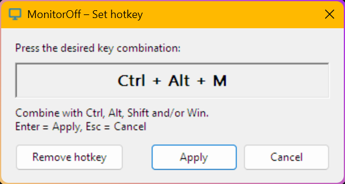

# MonitorOff

A tiny Windows tray tool that turns **all monitors off instantly** – without putting the computer to sleep.
Move the mouse or press a key and the monitors come back on.

It does exactly what the Windows power option *"Turn off my screen after x minutes"* does, just right now
instead of after a timeout. Downloads, renders, calls, music and everything else keep running.



## Features

- **One click** on the tray icon turns all monitors off
- **Global hotkey** (optional, freely configurable, e.g. `Ctrl + Alt + M`)
- **Command line**: `MonitorOff.exe --off` turns the monitors off once and exits – handy for shortcuts or scripts
- **Start with Windows** (optional)
- **Multilingual**: English and German included, follows the Windows display language by default,
  can be changed in the tray menu; more languages can be added with a simple JSON file
- Tray icon adapts to light/dark taskbar
- Single small `.exe`, no installation, no admin rights, no background service
- Pure Python + Win32 API via `ctypes` – no third-party runtime dependencies

## Download

Get `MonitorOff.exe` from the [Releases](../../releases) page and run it. The icon appears in the
notification area (you may have to drag it out of the overflow area `^` to keep it visible).

> **Note:** The exe is not code-signed. Windows SmartScreen may show *"Windows protected your PC"* on
> first launch – click *More info → Run anyway*. Some antivirus programs flag PyInstaller-built
> executables as false positives; if in doubt, [build it yourself](#building-from-source).

## Usage

| Action | Result |
|---|---|
| Left-click tray icon | Monitors off (after 1 second) |
| Hotkey | Monitors off (after 1 second) |
| Mouse / keyboard input | Monitors on again |
| Right-click tray icon | Menu: turn off, set hotkey, start with Windows, language, exit |

The one-second delay prevents the click or the key release itself from waking the monitors again.

### Setting a hotkey

Right-click the tray icon → **Set hotkey…**, press the desired combination and confirm with
**Apply** or `Enter`.

- Combine any key with `Ctrl`, `Alt`, `Shift` and/or `Win`.
- `F1`–`F24`, `Pause`, `Print Screen`, `Scroll Lock` and media keys may also be used alone.
- If the combination is already taken by another program or by Windows, the dialog tells you so.
- Many `Win + letter` combinations are reserved by Windows and cannot be used.

### Command line

```
MonitorOff.exe --off
```

Turns the monitors off once and exits. Works independently of a running tray instance.

## Languages

The UI language follows the Windows display language. If no translation exists for it, English is used.
You can override it via right-click → **Language**.

Translations are JSON files in the [`lang`](lang) folder (`en.json`, `de.json`).

### Adding a translation

1. Copy [`lang/en.json`](lang/en.json) to `lang/<code>.json`, where `<code>` is a language code such as
   `fr` or `pt-br` (matched against the Windows display language, e.g. `fr-FR` → `fr`).
2. Translate the values (not the keys). `language_name` is the name shown in the menu, written in that
   language. Keep placeholders like `{hotkey}` unchanged.
3. Either rebuild the exe, or put the file into a `lang` folder **next to** `MonitorOff.exe` – it is
   picked up on the next start without rebuilding.

Missing keys fall back to English. Pull requests with new translations are welcome.

## Settings

Settings are stored per user in the registry under `HKEY_CURRENT_USER\Software\MonitorOff`
(hotkey, language). "Start with Windows" creates the value `MonitorOff` under
`HKEY_CURRENT_USER\Software\Microsoft\Windows\CurrentVersion\Run`.

### Uninstall

1. Right-click the tray icon, uncheck **Start with Windows**, then **Exit**.
2. Delete `MonitorOff.exe`.
3. Optional: delete the registry key `HKEY_CURRENT_USER\Software\MonitorOff`.

## How it works

The app sends `WM_SYSCOMMAND` with `SC_MONITORPOWER = 2` through `DefWindowProc` of its own hidden
window. This is the same request Windows issues when the display timeout of the power plan expires:
the monitors enter standby, the system keeps running, and any input wakes the displays again.

## Building from source

Requirements: Windows 10/11 and [uv](https://docs.astral.sh/uv/).

```powershell
git clone https://github.com/Dreamfire78/MonitorOff.git
cd MonitorOff
powershell -ExecutionPolicy Bypass -File .\build.ps1
```

The result is `dist\MonitorOff.exe`. The script

1. renders the icons from [`monitor_icon.svg`](monitor_icon.svg) (`make_icon.py`, uses PyMuPDF and Pillow),
2. builds a single-file exe with PyInstaller.

Build dependencies are pinned in [`requirements-build.txt`](requirements-build.txt); the Python version
in [`.python-version`](.python-version).

To run directly from source without building (Python 3.10+ on Windows, no packages needed):

```powershell
pythonw monitor_off.py
```

### Project layout

| Path | Purpose |
|---|---|
| `monitor_off.py` | The application |
| `lang/*.json` | Translations |
| `monitor_icon.svg` | Icon source ([Boxicons](https://github.com/box-icons/boxicons-core) `monitor`, MIT) |
| `make_icon.py` | Generates `monitor_off.ico` (program), `monitor_off_light.ico` / `monitor_off_dark.ico` (tray) |
| `build.ps1` | Build script |
| `.github/workflows/build.yml` | CI build; attaches the exe to releases for `v*` tags |

## Known limitations

- On some systems a very sensitive mouse wakes the monitors right away. Increase `DELAY_MS` in
  `monitor_off.py` if that happens.
- Programs that actively keep the display on (e.g. some video players during playback, presentation
  software) may switch the monitors back on.
- Key names such as `Del` or `Page Down` are provided by Windows in the language of the active
  keyboard layout, not the app language.

## Credits

Icon: [`monitor`](https://icon-sets.iconify.design/boxicons/monitor/) from
[Boxicons](https://github.com/box-icons/boxicons-core) (MIT), found via [Iconify](https://iconify.design/).
See [THIRD-PARTY-NOTICES.md](THIRD-PARTY-NOTICES.md) for all third-party licenses.

## License

[MIT](LICENSE)
